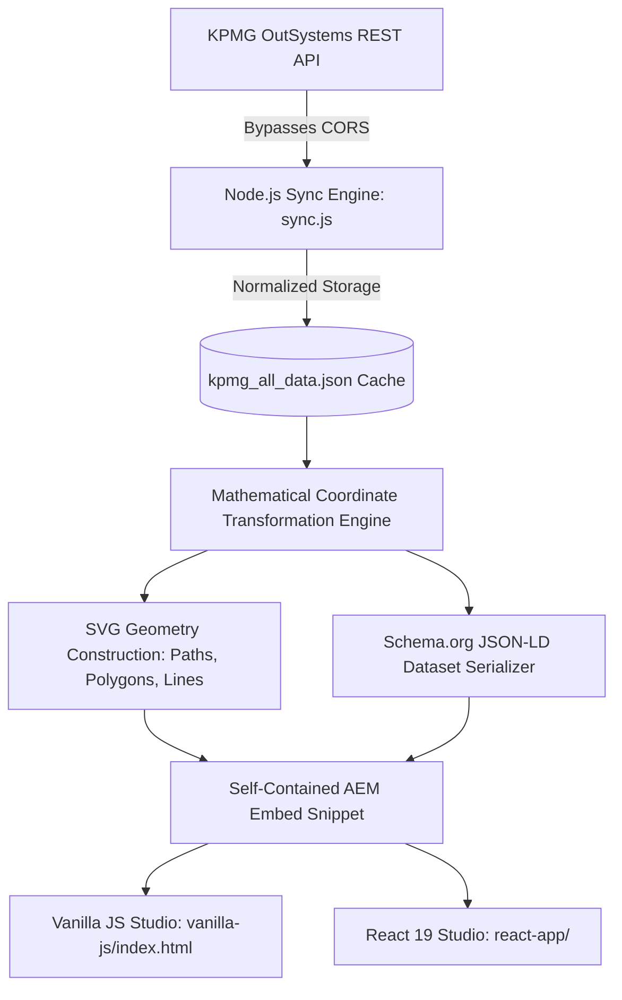

# KPMG Atlas | Technical Architecture & Implementation Guide
## How Raw REST API Data is Converted into Vector SVG Charts & Schema.org JSON-LD Metadata

---

## 📌 Executive Summary

This document explains the end-to-end technical methodology used to transform KPMG's Freemium REST API responses into:
1. **Lightweight, Zero-Dependency Vector SVG Charts & Tables** that render natively inside modern web apps and Adobe Experience Manager (AEM).
2. **Standard-Compliant Schema.org JSON-LD Dataset Metadata** that makes all financial statistics indexable by Googlebot, Google Dataset Search, and AI Search Crawlers.

---

## 🏗️ Architectural Overview: The 5-Step Pipeline



---

## 🔍 Detailed Step-by-Step Breakdown

### Step 1: Solving the CORS Problem via Node.js API Sync

#### The Problem:
KPMG's back-end endpoints (`https://live.kpmg-apps.de/DPS_Freemium_API/rest/Freemium/`) do not return permissive `Access-Control-Allow-Origin: *` headers for arbitrary browser domains or local `file://` contexts. Direct browser `fetch()` calls fail with CORS errors.

#### The Solution:
We implemented **`sync.js`**, a lightweight Node.js script utilizing native `https.get`.
- Node.js runs at the OS network level and is not subject to browser same-origin security policies.
- It concurrently requests all 11 endpoints:
  - `WACC_Values`, `WACC_Countries`, `WACC_SubIndustries`
  - `Multiples_Values`, `Multiples_Countries`, `Multiples_SubIndustries`
  - `MRP_BZ`, `BZ_CreditSpread`
  - `LRP_AverageOverTime`, `LRP_SelectedCountries`, `LRP_AverageLRPs`
- Normalizes and stores the structured responses into `kpmg_all_data.json`.
- Automatically rebuilds the studio artifacts.

---

### Step 2: Mathematical Coordinate Transformation (Raw Math, 0 Libraries)

Instead of using heavy 3rd-party charting libraries like D3.js or Chart.js (which add 300KB to 1MB of bloat and render rasterized canvas pixels that search engines cannot read), our engine computes pure 2D vector geometry using standard linear interpolation:

#### 1. Y-Axis Linear Transformation (Inverted Coordinate System):
In SVG, the origin `(0,0)` is at the **top-left**, while standard Cartesian charts put `0` at the bottom.
$$\text{scaleY}(v) = pT + cH - \left( \frac{v - \min_Y}{\max_Y - \min_Y} \right) \times cH$$
*Where:*
- $pT$ = Padding Top (e.g., `30px`)
- $cH$ = Usable Chart Height ($h - pT - pB$)
- $\min_Y, \max_Y$ = Data value minimum and maximum (e.g., `0.05` to `0.14`)

#### 2. X-Axis Linear Transformation:
$$\text{scaleX}(i) = pL + \left( \frac{i}{N - 1} \right) \times cW$$
*Where:*
- $pL$ = Padding Left (e.g., `60px`)
- $cW$ = Usable Chart Width ($w - pL - pR$)
- $i$ = Index of data point (e.g., Quarter 0 to Quarter 8)

---

### Step 3: SVG Vector Assembly

With coordinates calculated, the engine constructs SVG elements string by string:

#### 1. Range Bands (e.g., WACC Upper to Lower Band):
```javascript
const upperPts = rows.map((r, i) => `${scaleX(i)},${scaleY(r.WACC_Value_Upper)}`).join(" ");
const lowerPts = rows.slice().reverse().map((r, i) => `${scaleX(len - 1 - i)},${scaleY(r.WACC_Value_Lower)}`).join(" ");
const bandPathD = `M ${upperPts} L ${lowerPts} Z`;
// Result: <path d="M... L... Z" fill="#00b8f5" fill-opacity="0.45" />
```
*Why this works:* The polygon traces the upper line forward, connects directly to the lower line in reverse, and closes with `Z`, forming a shaded vector area.

#### 2. Trend Lines & Yield Step Curves:
- **Continuous Line**: Traced with `<path d="M x0 y0 L x1 y1 ... L xN yN" stroke="#00338D" stroke-width="2.5" fill="none" />`.
- **Step Curve**: Traced with horizontal and vertical step segments `H` and `V` to represent constant yield plateaus across maturities.

#### 3. Dual Floating Range Bars (EBITDA & EBIT Multiples):
- For each industry, an SVG `<rect>` is placed at:
  - `x = scaleX(Lower_Value)`
  - `width = scaleX(Upper_Value) - scaleX(Lower_Value)`
  - `fill = #00338D` (EBITDA) or `#00b8f5` (EBIT)

---

### Step 4: Schema.org JSON-LD Semantic Dataset Generation

Search engines cannot interpret graphic shapes or image pixels. To give KPMG top search authority, our generator builds a W3C-compliant `<script type="application/ld+json">` alongside every chart.

#### How It Maps API Fields to Schema.org Properties:
```json
{
  "@context": "https://schema.org",
  "@type": "Dataset",
  "name": "Automotive - Weighted average cost of capital over time",
  "description": "Automotive - Weighted average cost of capital over time structured dataset published via KPMG Atlas.",
  "creator": {
    "@type": "Organization",
    "name": "KPMG Deal Advisory"
  },
  "distribution": {
    "@type": "DataDownload",
    "encodingFormat": "application/json",
    "contentUrl": "https://live.kpmg-apps.de/DPS_Freemium_API/rest/Freemium/WACC_Values"
  },
  "hasPart": [
    {
      "@type": "Observation",
      "observationDate": "2026-09-30T00:00:00",
      "variableMeasured": [
        { "@type": "PropertyValue", "name": "Median of WACC", "value": 0.0811, "unitText": "%" },
        { "@type": "PropertyValue", "name": "Lower WACC", "value": 0.0696, "unitText": "%" },
        { "@type": "PropertyValue", "name": "Upper WACC", "value": 0.0956, "unitText": "%" }
      ]
    }
  ]
}
```

#### SEO & AI Benefits:
- **Googlebot**: Directly reads and indexes the quarterly numerical values.
- **Google Dataset Search**: Indexes the financial dataset automatically.
- **Generative AI / LLMs (Gemini, ChatGPT, Perplexity)**: Extracts authoritative source data without hallucinations.

---

### Step 5: Packaging for Adobe Experience Manager (AEM)

When a Content Author clicks **"Copy AEM Code"**, the generator produces an isolated snippet:

```html
<!-- KPMG Atlas Component: Automotive - Weighted average cost of capital over time -->
<div class="kpmg-atlas-chart-container" style="position:relative; max-width:100%; font-family:Inter, Arial, sans-serif; background:#fff; padding:0;">
  <!-- 1. Inline Vector SVG with KPMG Brand Colors -->
  <svg viewBox="0 0 600 320" style="width:100%; height:auto;">
    ...
  </svg>

  <!-- 2. Scoped Micro Tooltip Logic (Zero global namespace pollution) -->
  <div class="kpmg-chart-tooltip" style="position:fixed; display:none; ..."></div>
  <script>
    (function() {
      // Scoped event listener tracking data-tooltip attributes on hover
    })();
  </script>

  <!-- 3. Machine-Readable Schema.org JSON-LD Dataset -->
  <script type="application/ld+json">
    { ... }
  </script>
</div>
```

---

## 🎨 KPMG Brand Design System Tokens

| Token Name | Hex Code | Purpose in Charts & Tables |
| :--- | :--- | :--- |
| **KPMG Primary Blue** | `#00338D` | Median lines, EBITDA bars, table headers, primary buttons |
| **KPMG Pacific Blue** | `#00b8f5` | Shaded WACC range bands, EBIT multiple bars |
| **KPMG Purple Accent** | `#7213ea` | Total Return 3-line trend, special highlight lines |
| **KPMG Pink Accent** | `#fd349c` | Tenure step curve yield points, glowing diamond markers |
| **Body & Table Text** | `#666666` | Clean regular font (`400`) for headers, rows, and axis labels |

---

## 🗣️ Presentation Cheatsheet for Team & Stakeholders

### Q1: Why didn't we use D3.js or Chart.js?
> **Answer**: D3 and Chart.js add 300KB+ of script weight per page, hurt Core Web Vitals (INP/LCP), and render canvas pixels that Googlebot cannot read. Our custom SVG engine has **0KB library dependencies**, renders in under 5 milliseconds, scales losslessly to retina/4K displays, and is fully crawlable.

### Q2: How does this help AEM Content Authors?
> **Answer**: Authors don't need a developer or an AEM code release to publish a chart. They open the Studio, pick their sector & chart, click "Copy AEM Code", and paste it into an AEM Embed Component. It works immediately.

### Q3: How does Schema.org JSON-LD improve business value?
> **Answer**: Schema.org JSON-LD makes KPMG's valuation research machine-readable. When journalists, analysts, or clients search for "KPMG Automotive WACC", search engines can display KPMG's data in rich search cards and AI answer summaries.

### Q4: What is the difference between `vanilla-js/` and `react-app/`?
> **Answer**:
> - **`vanilla-js/index.html`**: A 100% self-contained single HTML file with embedded data. Requires zero installation (`npm` not needed). Can be double-clicked in any browser.
> - **`react-app/`**: A modern React 19 + Vite web application suitable for continuous integration, component libraries, and team frontend development.
